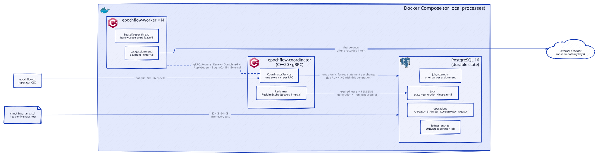
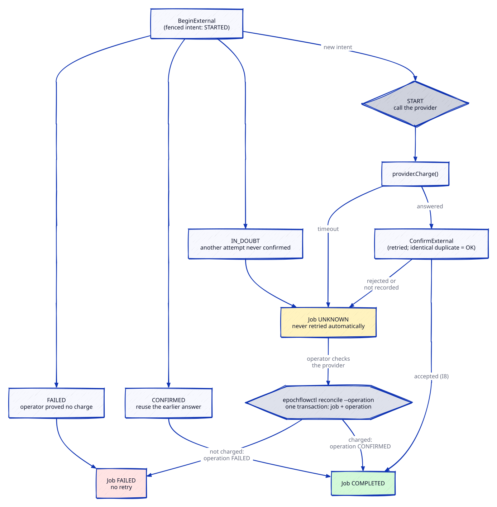
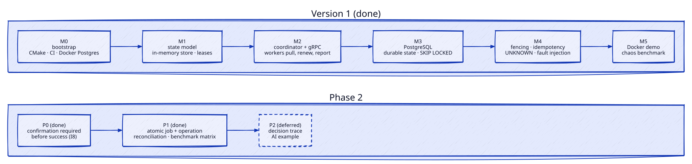

# EpochFlow

**A fault-tolerant distributed job execution engine for C++ workloads.**

EpochFlow assigns background jobs to independent workers, persists execution
state, and recovers safely when workers crash, pause, or lose network access.
It is a learning-focused systems project: the goal is to make distributed-systems
failure semantics explicit and verifiable, rather than to clone a production
cloud platform.

## Why it exists

A timeout or lost acknowledgement does not prove a job failed. A worker may have
already performed an external side effect before the coordinator retries it.
EpochFlow explores how a job engine can recover from those ambiguous failures
without letting stale workers overwrite newer work or blindly duplicating an
operation.

## Core guarantees

- **Durable job state:** job lifecycle information survives coordinator restarts.
- **Leased execution:** a worker owns a job only until its lease expires; it must
  renew while working.
- **Fencing:** every assignment has a monotonically increasing generation. A
  stale worker cannot commit a result after a newer assignment exists.
- **Idempotent operations:** retryable logical side effects use an operation ID
  so a retry returns the existing outcome instead of creating another one.
- **Explicit uncertainty:** an unconfirmed external request is not automatically
  treated as failed. It may be marked `UNKNOWN` until reconciliation is possible.

These guarantees do not provide magical exactly-once execution. Duplicate
*attempts* remain possible after failures; EpochFlow prevents or deduplicates the
effects it owns and makes unsupported external guarantees visible.

## Scope

One C++20 coordinator, independent C++20 workers, gRPC/Protobuf between them,
and PostgreSQL for durable jobs, leases, generations, and operations. Job
states: `PENDING`, `RUNNING`, `COMPLETED`, `FAILED`, `UNKNOWN`. Fault-injection
tests cover crashes, pauses, duplicate delivery, coordinator restarts, and lost
acknowledgements.

Out of scope: multi-region consensus, autoscaling, Kubernetes scheduling,
custom storage engines, and exactly-once guarantees for third-party APIs.

## Architecture



The coordinator assigns work and reclaims expired leases. Workers renew leases
on a separate thread, apply side effects through the coordinator, and report
with their assignment generation. PostgreSQL accepts a change only while the
job is still `RUNNING` with that generation, and deduplicates effects by
operation id. External effects the engine cannot deduplicate follow an
intent, confirm, or `UNKNOWN` path:



More diagrams (job lifecycle, fencing) and details:
[architecture](docs/architecture.md).

## Status



Phase 2 P0 and P1 are done ([Phase 2](docs/phase-2.md)):

- **P0:** a worker reports an external effect as done only after its
  confirmation is durably recorded; otherwise the job is `UNKNOWN` (invariant I8).
- **P1:** `epochflowctl reconcile --operation` resolves the job and its external
  operation in one transaction ([ADR 0006](docs/decisions/0006-operation-level-reconciliation.md)),
  and a seeded benchmark matrix replaces the one-seed sample.
- **P2** (decision trace, AI example) is deferred.

## Results

[Phase 2 benchmark matrix](docs/benchmarks/phase-2/summary.md): payments with a
1 s lease while a random worker is killed (SIGKILL) or frozen past its lease
(SIGSTOP) every 0.5 s. Each seed runs both modes on the same jobs and chaos
schedule; **naive** differs only in sending a fresh operation id per attempt,
like a client without idempotency keys.

- **Coverage:** 5 cells x 20 seeds x 2 modes = 200 runs, plus a single-worker
  stress test (1 worker, 1000 jobs, seeds 1-3, 6 runs) reported separately.
  No run failed.
- **Correctness:** EpochFlow had **0 duplicate effects, $0 overcharge, and 0
  invariant violations in all 206 runs**. Naive duplicated effects in 97 of 100
  main-grid runs (1,010 duplicate ledger entries).
- **Cost:** the median paired throughput ratio (EpochFlow / naive, same seed)
  is 1.00 to 1.09 per cell: no consistent throughput cost on this machine.
- **Recovery:** pooled median 1.0 s with 3 or 6 workers (about one lease);
  1.8 s with a single worker, which must itself restart or resume.

| Workers x jobs (20 seeds) | Runs with duplicates, EpochFlow / naive | Naive overcharge, median (max) | Throughput median, EpochFlow / naive (jobs/s) | Paired throughput ratio, median (range) |
| --- | --- | --- | --- | --- |
| 1 x 200 | 0 / 20 | $13.50 ($19.00) | 4.6 / 4.7 | 1.00 (0.70 to 1.41) |
| 3 x 200 | 0 / 20 | $4.00 ($8.00) | 26.3 / 28.2 | 1.00 (0.60 to 1.30) |
| 3 x 1000 | 0 / 20 | $21.00 ($29.00) | 30.4 / 29.8 | 1.01 (0.91 to 1.12) |
| 6 x 200 | 0 / 17 | $2.00 ($4.00) | 60.9 / 61.0 | 1.00 (0.39 to 1.18) |
| 6 x 1000 | 0 / 20 | $10.50 ($14.00) | 74.9 / 72.8 | 1.09 (0.80 to 1.19) |

In the stress test, naive duplicated 70 to 75 effects per run and EpochFlow
none, at 3.7 to 4.3 jobs/s in both modes. A few runs in both modes end with one
job `FAILED` after its three attempts were all interrupted. Measured on one
WSL2 laptop (16 vCPU) with PostgreSQL 16 in Docker on the same host; these are
not production numbers. See the summary for p95, spread, and limitations.

## Quick start

Requires Ubuntu 24.04 (or WSL2), Docker, and the apt packages listed in
[ADR 0001](docs/decisions/0001-cpp-toolchain-and-dependencies.md).

**Docker only** (no local build needed):

```bash
scripts/demo-docker.sh --down     # build, run, kill and freeze workers, check invariants
```

**Local build and tests:**

```bash
cmake --preset dev && cmake --build --preset dev
scripts/test-db.sh up
EPOCHFLOW_DSN="$(scripts/test-db.sh dsn)" ctest --preset dev     # all 200+ tests
scripts/bench.py --bin build/bin --dsn "$(scripts/test-db.sh dsn)" --mode compare
```

**Run it by hand:**

```bash
build/bin/epochflow-coordinator --dsn="$(scripts/test-db.sh dsn)" &
build/bin/epochflow-worker --worker-id=w1 --work-ms=200 &
build/bin/epochflow-worker --worker-id=w2 --work-ms=200 &
build/bin/epochflowctl wait $(build/bin/epochflowctl submit \
  --payload="task=payment;account=alice;amount_cents=500" --count=10)
```

See [operations](docs/operations.md) for flags, payloads, the `UNKNOWN`
runbook, and the benchmark.

## Documentation

- [Architecture](docs/architecture.md): components and data/control flows
- [Invariants](docs/invariants.md): safety properties and their enforcement
- [Protocol](docs/protocol.md): gRPC API semantics, errors, retry safety
- [Storage](docs/storage.md): PostgreSQL schema, transactions, migrations
- [Operations](docs/operations.md): running the binaries, configuration, logs
- [Testing](docs/testing.md): test layers, fault-injection scenarios, invariant checks
- [Phase 2](docs/phase-2.md): confirmation and reconciliation fixes, benchmark matrix
- [Benchmark results](docs/benchmarks/phase-2/summary.md): Phase 2 matrix, raw runs, environment
- [Decisions](docs/decisions/): ADRs
- [Diagrams](docs/diagrams/README.md): D2 sources and how to re-render them

Contribution and agent working rules are in [`AGENTS.md`](AGENTS.md).
